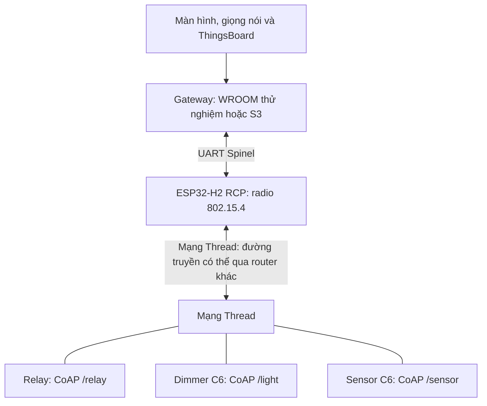
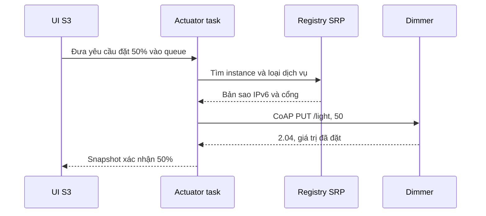

# Bàn giao Thread Mesh — Voice Gateway nhà thông minh

**Người phụ trách Thread: Phúc.** Tài liệu này dành cho thành viên mới nhận mã nguồn. Đọc mục 1–3 để hiểu hệ thống, mục 4–6 để chạy và tích hợp, mục 7–8 để xem quá trình làm và quy trình nghiệm thu. Mục 9–11 là sổ tay thực hành: nạp firmware, đọc log, lần theo code và chốt gói bàn giao. Phiên bản chạy thử dùng **WROOM + ESP32-H2 RCP**; phiên bản đích dùng **ESP32-S3 + cùng H2 RCP**.

## 1. Hệ thống hiện có



Sơ đồ mô tả các thành phần, không cố định đường đi của gói tin. OpenThread, CoAP, Commissioner, SRP Server và logic điều khiển chạy trên **host**. H2 RCP thực hiện phần radio; không viết giao thức UART riêng kiểu `ACK:RELAY:ON`. Có hai board H2 nếu relay đang dùng H2: **H2 relay và H2 RCP là hai thiết bị khác nhau**.

| Thiết bị | Vai trò và chức năng | Cách kiểm tra |
|---|---|---|
| WROOM + H2 RCP | Gateway thử nghiệm, ESP-IDF 5.5.5. Monitor COM4. | `ot state`, `ot srp server state`, `ot srp server service`. |
| Relay | Một kênh, GPIO12 kích mức thấp trong bản đã thử. Firmware có khả năng làm router, vai trò thực tế do mạng quyết định. | Một node SRP `relay-01`; `GET /relay` trả `ON` hoặc `OFF`. |
| Dimmer C6 | LEDC PWM GPIO22, 5 kHz, 10 bit. Mức điều khiển là số nguyên 0–100%. | SRP `dimmer-test-01`; `GET /light` trả mức đang đặt. |
| Sensor C6 | DHT11 trên GPIO10, khoảng 5 giây/mẫu, COM8. MTD chạy dạng Sleepy End Device. | `ot state` → `child`, `ot mode` → `-`, `ot pollperiod` → `1000`. |

Phạm vi hiện tại: **một relay, một dimmer, một sensor DHT11**. ThingsBoard và giao diện/giọng nói trên S3 là phần tích hợp tiếp theo.

## 2. Thread Mesh cần biết để đọc code

**Thread** là mạng IPv6 công suất thấp chạy trên IEEE 802.15.4, dùng 6LoWPAN để thích nghi IPv6 với các khung radio nhỏ. **OpenThread** là phần mềm hiện thực giao thức. **CoAP** là giao thức ứng dụng trên UDP để đọc/điều khiển thiết bị. **SRP** đăng ký tên dịch vụ, địa chỉ và cổng để gateway tìm nơi gửi CoAP. Vì có các lớp riêng, một node có thể đã vào Thread nhưng chưa có bản ghi SRP, hoặc có bản ghi SRP mà hiện không còn trả lời CoAP.

| Khái niệm | Ý nghĩa trong đồ án |
|---|---|
| **Router / Leader** | Router chuyển tiếp gói cho các node khác. Leader quản lý thông tin của một partition và cũng là router; không phải gateway điều khiển ứng dụng. Vai trò có thể thay đổi. WROOM từng lên `child` trước, sau đó tự lên `router`. |
| **FTD / MTD** | FTD có thể được cấu hình để đủ điều kiện làm router; FTD đang là child chưa chuyển tiếp như router. MTD chỉ làm child. Dimmer/relay có thể chuyển tiếp khi thực sự ở vai trò router, sensor MTD thì không. |
| **Parent / SED** | Sensor trao đổi qua parent. Parent giữ bản tin chờ sensor hỏi. Poll period 1000 ms là nhịp hỏi parent, không phải nhịp đo DHT11 hay nhịp gateway đọc. Mode `-` cho thấy cấu hình SED, không chứng minh cả board đã deep sleep hay đã đo mức tiêu thụ pin. |
| **Border Router / RCP** | Border Router nối Thread với mạng IP khác. Vai trò đó độc lập với Leader. RCP là radio nối host bằng Spinel/UART. Kiểm thử CoAP nội bộ không tự xác nhận việc định tuyến IPv6 sang Wi-Fi đã hoạt động. |
| **Active Dataset** | Cấu hình vận hành mạng: kênh, PAN ID, thông tin định danh, tiền tố và khóa mạng. Các node cùng mạng cần thông tin mạng tương thích. Chuỗi hex xuất từ CLI chứa bí mật, chỉ lưu riêng trong nhóm. |
| **EUI-64 / PSKd** | EUI-64 nhận dạng board. PSKd là mã dùng để xác thực lúc thêm node. Hai thứ này khác nhau và đều khác dataset. Có thể mở quyền theo đúng EUI-64, hoặc dùng mục `*` theo mã trong phiên thử giới hạn. |
| **ML-EID / RLOC / fe80::** | ML-EID dùng để liên lạc bên trong mesh và có thể đổi sau factory reset/ghép lại. RLOC phụ thuộc vị trí trong mạng (ví dụ đổi parent/role). Địa chỉ link-local `fe80::` chỉ dùng trên liên kết, không dùng làm endpoint đi xuyên mesh. |
| **Hop / Partition** | Hop là một chặng truyền. Router có thể tạo đường thay thế nếu còn liên kết phù hợp. Partition ID giúp đối chiếu các node có đang cùng phần mạng hoạt động hay không; không dùng làm định danh thiết bị hoặc bằng chứng CoAP đã hoạt động. |

**Vì sao không ghi cứng IPv6:** trước đây khi dimmer/sensor ghép lại, ML-EID thay đổi. Gateway cần tìm endpoint theo tên instance và loại dịch vụ. Mục đích là dùng IPv6 **từ bản đăng ký hiện tại**; không suy loại node từ địa chỉ IPv6 hay từ vai trò Thread.

## 3. Đọc code theo thứ tự này

Tên dưới đây là tên module trong dự án; tên file tải lên có thể có hậu tố. Khi giao code, gửi **bản hiện tại từ máy Phúc**, không dùng nhầm snapshot WROOM cũ còn macro IPv6 hoặc timeout 12 giây. Tài liệu mô tả luồng tích hợp đã thảo luận và kết quả có log; không thay cho việc kiểm tra commit được bàn giao.

| Mở file | Tìm gì | Vì sao thiết kế như vậy |
|---|---|---|
| Gateway: `main/esp_ot_config.h` | Spinel UART: trên WROOM đang dùng UART1, RX16/TX17, 460800 baud, 8N1, không flow control. | Tách cấu hình phần cứng khỏi logic. Khi sang S3 chọn GPIO/UART phù hợp và đấu chéo TX–RX, GND chung. |
| Gateway: `main/esp_ot_br.c` | `app_main()`: NVS, netif, OpenThread, khôi phục dataset, CoAP dùng chung, SRP Server, khởi tạo client. | Khởi tạo stack và một CoAP instance trước khi client gửi. Không tạo dataset mới nếu đang khôi phục mạng cũ. |
| Gateway: `device_registry.c/.h` | Tra tên instance + loại dịch vụ trong bảng SRP, bỏ mục đã xóa, lấy IPv6/cổng. | Không giữ con trỏ vào bảng OpenThread sau khi thả lock; sao chép endpoint ra struct. Hàm hậu tố `_locked` được gọi khi caller đã giữ lock. |
| Gateway: `actuator_client.c/.h` | `actuator_set_relay()`, `actuator_set_brightness()`, các hàm read, `actuator_get_snapshot()`. | API nhận lệnh vào queue, task gửi CoAP, callback báo kết quả. Giao diện không cần chặn để đợi mạng. |
| Gateway: `sensor_client.c/.h` | `sensor_poll_task()`, `sensor_send_get_locked()`, `sensor_response_handler()`, `sensor_client_get_snapshot()`. | Mỗi khoảng 10 giây tìm sensor rồi GET. Callback sao chép response; task kiểm tra JSON. Nếu request trước còn pending thì bỏ qua chu kỳ để tránh chồng request. |
| Node: file chứa `app_main()` | Init GPIO/PWM/DHT, handler CoAP, khôi phục dataset, task SRP, task BOOT. Dimmer: `node_b_main.c`. Sensor: `node_sensor_main.c`. | Mỗi node giữ chức năng riêng; dùng lại mẫu ghép và đăng ký. Không copy cả `app_main()` giữa các board. |
| Sensor: `node_sensor_main.c` | `sensor_sampling_task()`, `sensor_request_handler()`, `pair_try_join()`, `node_srp_task()`. | Task lấy mẫu cập nhật cache dưới mutex. GET đọc bản sao cache, không gọi driver DHT11 ngay trong callback. SRP chờ đến khi node attach; role `child` là đủ. |
| Mỗi dự án: `CMakeLists.txt`, `idf_component.yml`, `sdkconfig` | Danh sách source, dependencies và cờ OpenThread cho đúng target. | Cấu hình Host/RCP/native radio, FTD/MTD, Commissioner/Joiner và SRP là khác nhau giữa các dự án. |

### Hợp đồng CoAP và trạng thái giao diện

| Thiết bị | Lệnh | Xác nhận mong đợi |
|---|---|---|
| Relay | `PUT /relay`, payload ASCII `ON` hoặc `OFF`. | `2.04 Changed` và trạng thái node báo lại. `GET /relay` trả `2.05 Content`. |
| Dimmer | `PUT /light`, payload ASCII số nguyên `0..100`. | `2.04` và mức đã đặt. `GET /light` trả `2.05` và mức đang lưu. 50% nghĩa là mức PWM được đặt, không phải phép đo lux. |
| Sensor | `GET /sensor`. | `2.05` và JSON gồm `node_id`, nhiệt độ, độ ẩm, `sample_seq`, `age_ms`, `last_read_ok`, `stale`. Chưa có mẫu có thể trả `5.03`. |

**Ghi nhớ khi ghép UI:** `ESP_OK` khi gọi API actuator hoặc `Done` trên CLI chỉ báo lệnh được tiếp nhận, chưa báo thiết bị đã thực thi. Đợi trạng thái xác nhận và giá trị khớp rồi mới cập nhật UI/ThingsBoard. Timeout nghĩa là **chưa xác nhận**, có thể đọc lại bằng GET. Phản hồi node xác nhận giá trị phần mềm; không chứng minh tiếp điểm relay đóng bằng một phép đo độc lập.

OpenThread API nhận `otInstance` từ task ngoài callback cần dùng lock theo quy tắc của ESP-IDF. Thả lock trước khi chờ queue. Một queue response dùng chung chỉ an toàn khi giữ đúng một giao dịch actuator đang chờ: **nếu bản code còn tự bỏ chờ sau 12 giây trong khi OpenThread vẫn tiếp tục giao dịch, sửa trước khi tích hợp**. Có thể đợi callback kết thúc, hoặc thiết kế cơ chế hủy/đối chiếu giao dịch để response cũ không bị gán cho lệnh mới.

Sensor đo khoảng 5 giây/lần và gateway đọc khoảng 10 giây/lần nên `sample_seq` thường tăng 2 giữa hai lần nhận. Đây không phải dấu hiệu mất gói. Mẫu của sensor có thể cũ sau khi gateway mất liên lạc: UI phải xem cả trạng thái và thời điểm nhận snapshot; không coi `stale=false` từ lần nhận trước là còn mới mãi.

## 4. Luồng thêm một node bằng nút BOOT

1. **Gateway** mở Commissioner, đợi `active`, rồi đăng ký quyền ghép có thời hạn với PSKd. Có thể chỉ định EUI-64 để giới hạn đúng board. Bản lab dùng CLI; giao diện S3 sẽ thay thao tác này.
2. **Node chưa có dataset**: người dùng giữ BOOT khoảng 2 giây **sau khi firmware đã chạy**. Firmware bật IPv6, gọi `otJoinerStart()`, chờ kết quả tối đa khoảng 60 giây. Nhấn nhanh không kích hoạt. Đã có dataset thì không tự xóa mạng khi nhấn giữ.
3. **Joiner thành công:** node đã nhận cấu hình; firmware tự bật Thread. Chờ role `child` hoặc `router` tùy node. Sensor giữ cấu hình SED.
4. **Attach xong:** node đăng ký SRP. `SRP registration initiated` chỉ là đã bắt đầu; `Registered` mới xác nhận server nhận đăng ký.
5. **Gateway tìm đúng node và đọc thử CoAP:** chỉ lúc này UI mới nên báo **Đã thêm thiết bị**. Nếu dừng ở bước 3, báo đang tìm dịch vụ thay vì báo sai PSKd.

**Ví dụ lab:** trên COM4 dùng `ot commissioner start`, `ot commissioner state`, rồi `ot commissioner joiner add <EUI64_CUA_NODE> <PSKD_LAB> 60`. Thay chỗ giữ chỗ, bỏ dấu ngoặc nhọn. Bấm BOOT trên node sau khi `joiner add` trả `Done`. Kết thúc chạy `ot commissioner stop`. Không đưa PSKd thật vào log, tài liệu hoặc repo công khai. BOOT trên board là chân chọn chế độ khởi động: không giữ cùng lúc cấp nguồn hoặc nhấn RESET.

**Tránh lỗi trùng tên SRP khi thử ghép lại:** khởi động lại bằng EN/RESET vẫn giữ mạng đã lưu. Chỉ dùng `ot factoryreset` trên **đúng node** khi cần mô phỏng thiết bị mới. Trước khi reset, sao lưu dataset và, nếu node còn `Registered`, chạy `ot srp client host remove 1` trên node rồi xác nhận bản ghi đã rời bảng SRP. Thao tác này nhả cả phần giữ tên (*key lease*). Nếu reset trước, node có thể dùng khóa đăng ký SRP mới trong khi server vẫn giữ tên cho khóa cũ. **Tên dịch vụ là cách tìm endpoint, không phải bằng chứng xác thực node.**

## 5. Chạy thử và khoanh vùng lỗi

**Build:** mở terminal ESP-IDF đúng phiên bản và thư mục dự án. WROOM/relay/dimmer/sensor là các project riêng. Dùng `idf.py build` rồi `idf.py -p COMx flash monitor`. COM4 cho WROOM, COM8 cho sensor theo máy Phúc; kiểm tra COM thật của hai board còn lại trước khi nạp. Không `erase-flash` trong bài thử thông thường.

**Trình tự kiểm tra trên COM4:**

```text
ot state
ot srp server state
ot srp server service
```

WROOM phải vào Thread và SRP Server phải `running`. Dùng địa chỉ mới nhất từ bảng để kiểm tra. Thay `<IP_RELAY>`, `<IP_DIMMER>` bằng IPv6 tương ứng, không gõ dấu ngoặc nhọn:

```text
ot coap put <IP_RELAY> relay con ON
ot coap put <IP_RELAY> relay con OFF
ot coap put <IP_DIMMER> light con 50
ot coap get <IP_DIMMER> light con
```

Gõ từng lệnh, đợi phản hồi. Sensor có thể để firmware tự đọc; cặp log `Found service via SRP` → `SENSOR_RX` chứng minh luồng ứng dụng đã tìm và đọc. CLI điều khiển relay/dimmer bằng IP lấy từ SRP là bài xác nhận kết nối; để kiểm tra **API tự tra SRP**, phải gọi API từ UI/test code. Tên hàm C không phải lệnh terminal.

| Dấu hiệu | Kiểm tra đầu tiên |
|---|---|
| `Failed to reset co-processor` | Đúng H2 RCP? Kiểm tra nguồn, GND, dây TX/RX, cấu hình UART, baud, firmware Spinel. |
| `commissioner ... InvalidCommand` | Kiểm tra bản build host có Commissioner và FTD; đúng project/firmware đã nạp. |
| `InvalidState` khi add Joiner | Kiểm tra Commissioner đã thực sự `active`. |
| `NotFound` / `Security` khi ghép | Kiểm tra thời hạn, PSKd và EUI-64. Đối chiếu log Joiner/Commissioner, trạng thái và lỗi radio; chưa thể quy nguyên nhân chỉ từ một dòng `NoAck` hay `Security`. |
| Có bản ghi SRP nhưng GET timeout | So IPv6 trong bảng với `ot ipaddr mleid` trên node. Kiểm tra role, handler CoAP và xem có `Name conflict` không. |
| `SENSOR_NOT_DISCOVERED` ngay sau boot | Sensor có thể chưa attach/đăng ký. Đợi bản ghi mới rồi kiểm tra `SENSOR_RX`. |
| Lỡ factory reset WROOM | Lấy `ot dataset active -x` từ dimmer/relay còn mạng. Trên WROOM đang dừng Thread: `ot dataset set active <HEX>`, `ot ifconfig up`, `ot thread start`. Đợi node đăng ký SRP lại; không tạo mạng mới. |

## 6. Bàn giao để ghép với S3 của Vinh

**Phúc gửi:** bản source cuối của WROOM, relay, dimmer, sensor; cấu hình dự án RCP; phiên bản IDF, target, commit/nhãn phiên bản, `sdkconfig` hoặc `sdkconfig.defaults`, manifest và lockfile nếu có. Kèm log BOOT/Joiner/SRP/CoAP, ghi rõ board và kết quả mỗi bài. Gửi dataset lab **riêng**, chỉ cho thành viên cần cấu hình. Không cần gửi thư mục `build` để đem nạp qua chip khác.

**Vinh thực hiện theo thứ tự:**

1. Dùng **dự án thử S3 trên ESP-IDF 5.4.3** với target `esp32s3`. Sao lưu chương trình gateway hiện có. Tắt nguồn rồi chuyển H2 RCP từ WROOM sang S3; không nối cùng lúc vào hai host. Giữ bản H2 đang chạy để thử trước, kiểm tra handshake UART/Spinel thực tế. Không copy nguyên `sdkconfig` WROOM sang S3 hay mặc định hai phiên bản firmware chắc chắn tương thích.
2. Khi S3 nhận H2, nhập dataset lab đã lưu để vào cùng mạng. Kiểm tra role và SRP Server; chờ bảng đủ ba node. Khi chuyển sang gateway triển khai ở nhà mới, tạo dataset riêng thay vì dùng lại dataset lab.
3. Port `device_registry`, `sensor_client`, `actuator_client` vào dự án thử. Ghép một nút đặt dimmer 50%, một nút relay ON/OFF và một ô DHT11. Kiểm tra riêng kết quả API **tự tra SRP → gửi CoAP → xác nhận** rồi mới ghép giọng nói và ThingsBoard.
4. Làm màn hình **Thêm thiết bị**: bắt đầu/hủy phiên, đếm giờ, báo đang đợi BOOT, báo đã attach, rồi báo đã thêm sau GET thử. Dùng một phiên tại một thời điểm cho demo. Giao diện, voice và cloud đi qua cùng API để dùng chung trạng thái xác nhận. Với nhiều node cùng loại, cần chọn theo ID riêng; không lấy mục đầu tiên cùng loại.

**Mốc có bằng chứng:** WROOM đã phục hồi sau factory reset, lên router, SRP có đủ ba bản ghi và DHT11 tiếp tục trả dữ liệu. Có log dimmer và sensor dùng BOOT để ghép; sensor có log WROOM tự tìm địa chỉ mới rồi GET thành công. Bản ghi relay trong SRP xác nhận đăng ký; lưu riêng log ghép BOOT relay nếu đã thử. **Chưa đánh dấu đạt** cho S3, UI Thêm thiết bị, tích hợp ThingsBoard hay actuator API tự tra SRP nếu mới thử bằng CLI.

**Số liệu cho báo cáo:** giữ log từng lần đo và topology. Ví dụ ba lần phục hồi ping khi ngắt router thử nghiệm là 9,18 s, 9,30 s, 9,18 s (trung bình 9,22 s). Ghi rõ mốc đo là từ lúc rút nguồn đến khi ping ổn định, theo cách thử của nhóm. Không dùng kết quả này để suy thời gian SED đổi parent hoặc độ trễ điều khiển bằng giọng nói.

## 7. Nhật ký kỹ thuật: Phúc đã làm gì và vì sao?

Phần này bổ sung bối cảnh cho người nhận code. Mỗi mốc ghi **việc đã làm, cách kiểm chứng và giới hạn của kết quả**. Với các chỉ số định lượng, dùng log gốc của nhóm khi đưa vào báo cáo.

### 7.1. Dựng mạng và thay gateway thử nghiệm

- **Giai đoạn đầu:** thiết lập mạng Thread, cho các board dùng chung Active Dataset, xác nhận role bằng `ot state`. Từ host gửi CoAP để bật/tắt relay và chỉnh PWM. Mục đích là kiểm tra cả đường truyền lẫn chức năng thiết bị; chỉ thấy các board cùng mạng chưa chứng minh lệnh ứng dụng chạy.
- **Phân vai lại phần cứng:** dùng WROOM làm host, giữ H2 làm RCP, rồi tái sử dụng C6 host cũ làm sensor. WROOM không dùng radio Thread tích hợp; phần trao đổi 802.15.4 đi qua H2. Vì vậy không thể chỉ cắm WROOM vào máy rồi mong nó tự thấy các node.
- **Lỗi đã gặp:** WROOM từng báo `Failed to reset co-processor!` trong khi H2 vẫn chạy với host cũ. Sau khi xử lý cấu hình/kết nối, log WROOM có khởi tạo Spinel UART và reset co-processor thành công. Đó là mốc kiểm tra riêng của đường host–radio, trước cả kiểm tra dataset.
- **Tự vào lại mạng:** gateway và các node kiểm tra dataset đã lưu; nếu có thì bật IPv6 và Thread. Gateway không tự tạo mạng mới khi chỉ cần khôi phục mạng cũ. Nhờ vậy khi chuyển host hoặc khởi động lại thiết bị, không phải ghép từng node nếu dataset trên chúng vẫn còn.

### 7.2. Kiểm thử một chặng, nhiều chặng và tự phục hồi

| Bài thử | Bố trí và bằng chứng | Điều có thể kết luận |
|---|---|---|
| Một chặng | Loại relay trung gian khỏi phép thử; giữ đường trực tiếp host–dimmer. Lưu bảng router/neighbor và thống kê ping. | Có trao đổi trực tiếp trong cấu hình thử đó. Ping thành công khi cả ba board ở gần chưa đủ để xác nhận một hay hai chặng. |
| Hai chặng | Bài lab chặn liên kết trực tiếp host–dimmer theo hai chiều, giữ đường qua relay. Trong log, hai đầu vẫn thấy relay làm neighbor; bảng router có next hop qua relay. Kiểm tra ping và điều khiển dimmer. | Relay đã chuyển tiếp trong **topology được bố trí cho bài thử**, không phải mọi lệnh trong hệ thống luôn đi qua relay. |
| Tự phục hồi | Bố trí có đường thay thế, ngắt nguồn router trung gian và đo đến khi ping ổn định. Các lần ghi nhận: 9,18 s; 9,30 s; 9,18 s, trung bình 9,22 s. | Mạng đã đổi đường trong kịch bản thử. Đây là thời gian phục hồi quan sát bằng ping, không phải SLA, thời gian khôi phục của SED hay độ trễ giọng nói. |

**Ghi chú tái hiện:** lưu role, neighbor/router table, trạng thái lọc và địa chỉ dùng khi ping. Nếu dùng lọc MAC hoặc chỉnh chất lượng liên kết cho bài đo, ghi rõ đây là cấu hình lab và trả lại cấu hình bình thường sau khi đo. `NoAck` nghĩa là một lần truyền không được xác nhận ở tầng liên kết; dùng bảng router/next hop và phản hồi đầu cuối để xác định đường đi, không dùng riêng dòng `NoAck`.

### 7.3. Từ node điều khiển được đến gateway biết trạng thái

- **Relay:** giữ một kênh. Đầu ra phần mềm ON/OFF cần được trả về sau khi node xử lý. Ảnh thử cho thấy `PUT ON/OFF` trả `2.04`, `GET` trả `2.05`. Vì vậy UI có thể dựa vào giá trị xác nhận, thay vì đổi trạng thái ngay lúc người dùng bấm.
- **Dimmer:** thay đầu ra bật/tắt bằng PWM. Với độ phân giải 10 bit, code đổi phần trăm thành duty theo `percent * 1023 / 100`. Giá trị 0 là tắt theo thiết kế khởi động; GET trả giá trị đang lưu. Thanh trượt có thể chọn từng mức nguyên 0–100. Khi ghép UI, gửi mức cuối hoặc gom các thay đổi để tránh xếp hàng quá nhiều lệnh lúc kéo.
- **Một CoAP instance trên host:** chuyển việc mở CoAP vào phần khởi tạo gateway, rồi chạy sensor client và actuator client. Mỗi client xử lý công việc riêng nhưng dùng chung OpenThread. Không gọi lại `ot coap start` chỉ vì một node chậm trả lời; trước hết kiểm tra endpoint và phản hồi.
- **Vì sao dùng callback và queue:** lúc gửi thành công, ứng dụng chỉ biết yêu cầu được tiếp nhận. Callback nhận code/payload hoặc lỗi; worker mới đối chiếu với lệnh và cập nhật snapshot. Để dễ hiểu khi đọc log: `Done` → yêu cầu được gửi/tiếp nhận; `2.04` + giá trị khớp → node xác nhận cập nhật; `2.05` → đọc được trạng thái. Khi mất phản hồi, GET lại là cách kiểm tra trạng thái thực tế của phần mềm node.

### 7.4. DHT11, SED và ba mốc thời gian khác nhau

1. **5 giây:** node lấy mẫu DHT11. Khi đọc lỗi, giữ mẫu tốt cuối và đánh dấu tình trạng đọc lỗi. `sample_seq` tăng khi có mẫu hợp lệ mới.
2. **1 giây:** poll period Thread của SED. Đây là thời gian kiểm tra dữ liệu chờ từ parent, không phải số đo điện năng hoặc thời gian phản hồi cố định.
3. **10 giây:** gateway chủ động GET. GET đọc mẫu có sẵn, không khởi động một lượt đo DHT11 mới. Vì thế thấy seq tăng 2 là phù hợp. Nếu chưa có mẫu đầu tiên thì có thể nhận `5.03`; nếu có mẫu cũ, xem `age_ms`, `last_read_ok` và `stale`.

**Các lỗi đã được thử:** ngắt nguồn sensor để xem timeout rồi cấp lại; ngắt dữ liệu DHT11 để xem firmware giữ mẫu trước và đánh dấu cũ; kiểm tra getter của gateway trong cả giai đoạn chưa có dữ liệu và khi đang cập nhật đều. Một bản cũ từng in `SENSOR_RECOVERED` rồi ngay lập tức báo `SENSOR_READ_ERROR` ở mỗi poll. Sau khi sửa, chỉ báo phục hồi khi nhận được mẫu đọc tốt và chưa cũ. Vinh cần áp dụng cùng tiêu chí khi đổi màu trạng thái trên UI.

**Đổi parent:** sensor đã được thử bám dimmer thay vì WROOM, và WROOM đọc lại được khi quay vào mạng. Sensor vẫn là child; dimmer làm parent trong lúc thử đó. Không lấy thời gian từ log `detached` đến `child` để gọi là thời gian từ lúc rút nguồn đến khi phục hồi: đó chỉ là đoạn attach sau khi node đã phát hiện mất kết nối.

### 7.5. Từ địa chỉ cố định đến SRP và ghép bằng BOOT

| Trình tự làm | Kết quả và lý do |
|---|---|
| Ghép mặc định bằng dataset trong lab | Nhanh để dựng mạng và kiểm tra CoAP. Về sau vẫn hữu ích để cứu host bị reset, nhưng không phù hợp làm thao tác hằng ngày cho người dùng. |
| Thử Commissioner/Joiner bằng CLI | Tách cơ chế Thread khỏi UI. WROOM từng trả `InvalidCommand` trước khi bật tính năng build; sau đó `InvalidState` khi có tính năng nhưng Commissioner chưa active. Đợi `active` rồi mở quyền mới đúng. |
| Thử SRP với dimmer, rồi thêm relay và sensor | Gateway tìm endpoint từ service thay vì đoán theo IP cũ. Đã thấy bảng có đủ ba dịch vụ. Với sensor có log ứng dụng tra SRP và GET tự động; với actuator, nếu bằng chứng chỉ là CLI thì ghi đúng là CLI. |
| Làm BOOT trên node | Kiểm tra giữ nút một lần khi còn dataset trước, rồi mới thử board chưa có dataset. Firmware node xử lý Joiner và bật Thread; terminal WROOM vẫn dùng để mở quyền lab. |
| Xử lý bản ghi SRP giữ tên sau khi reset | Dimmer từng báo `Name conflict`, trong khi WROOM còn bản ghi IP cũ và ping/GET timeout. So ML-EID trực tiếp trên node trước. Lần thử tiếp theo, gỡ đăng ký và key lease trước khi reset node nếu có thể. |
| Kiểm chứng sensor sau ghép BOOT | Log có `PAIR_SUCCESS`, `detached → child`, đăng ký SRP và GET `2.05`. WROOM tra ra địa chỉ mới và nhận đúng mẫu seq 55 mà node báo trả. Sensor từng gặp `NotFound` và `Security`; đợt sau thành công, nhưng chưa có bằng chứng đủ để quy lỗi cũ cho riêng mode SED, PSKd hoặc radio. |

### 7.6. Khôi phục WROOM sau khi lỡ factory reset

Đây là bài thực tế đã làm, không chỉ là hướng dẫn dự phòng. Dataset được lấy lại từ node còn mạng và nhập vào WROOM. Gateway vào lại với role `child`, SRP Server lên `running`, bảng có đủ dimmer/sensor/relay. Sau đó WROOM chuyển lên `router` trong khi `SENSOR_RX` vẫn tiếp tục. Không phải ghép lại ba node.

**Vì sao đáng lưu:** cấu hình mạng không chỉ tồn tại ở một board. Lấy đúng dataset của mạng còn hoạt động giúp host quay lại. Việc thấy role `child` trước `router` không phải lỗi. Đối với relay/dimmer, vẫn cần lệnh và phản hồi CoAP nếu muốn xác nhận chức năng sau khôi phục; tên trong bảng SRP chưa đủ.

## 8. Bảng nghiệm thu để Vinh tự chạy lại

| Mốc | Thao tác | Bằng chứng cần lưu | Trạng thái theo cuộc trao đổi |
|---|---|---|---|
| Host ↔ RCP | Boot WROOM + H2 | Handshake Spinel, không còn lỗi reset co-processor | Đã chạy trên WROOM |
| Thread ↔ SRP | Kiểm tra COM4 sau khôi phục | `ot state`, SRP `running`, ba bản ghi | Đã có log |
| Sensor tự tra SRP | Đợi gateway tự poll | `Found service via SRP` và `SENSOR_RX` cùng chu kỳ | Đã có log |
| Ghép dimmer/sensor bằng BOOT | Mở quyền lab, giữ nút node | Joiner xong, attach, SRP và GET | Đã có log; lưu riêng log của từng node |
| Ghép relay bằng BOOT | Thực hiện trên relay nếu chưa có log | `PAIR_SUCCESS`, attach, SRP, GET/PUT `/relay` | Kiểm tra lại bằng chứng riêng; đã thấy bản ghi SRP |
| Relay/dimmer tự tra SRP qua API | Gọi API từ UI hoặc lệnh test của ứng dụng | Tra endpoint, code/payload khớp, snapshot xác nhận | Không lấy kết quả CLI thay cho bài API |
| S3 + H2 và giao diện | Thử trên dự án riêng rồi nối UI | Boot, role, SRP, relay/dimmer/DHT11, nút Thêm thiết bị | Cần kiểm thử trên S3 |
| Giọng nói và ThingsBoard | Gọi cùng API từ các nguồn lệnh | Lệnh được xác nhận, dữ liệu cập nhật, lỗi có trạng thái rõ | Phần tích hợp tiếp theo |

**Cách tổ chức gói gửi:** mỗi firmware để một thư mục riêng, ghi rõ board và target. Đặt README ở ngoài cùng. Trong thư mục log, đặt tên theo **board–bài thử–lần đo**, ví dụ `sensor-boot-join-pass.txt`. Với mỗi bài, ghi phiên bản code, bố trí board, lệnh đã nhập, phản hồi và kết luận. Các giá trị mật khẩu/mã ghép thật và dataset để riêng khỏi gói chia sẻ công khai.

**Gợi ý buổi bàn giao đầu tiên:** cho thành viên mới xem sơ đồ rồi tự tìm ba node trong bảng SRP. Sau đó họ thử đặt dimmer 50%, đọc lại và đối chiếu code/payload. Cuối buổi, mở `device_registry` và hai client để chỉ ra ba chỗ: tra endpoint, gửi request, nhận xác nhận. Khi hiểu luồng đó mới đọc Commissioner và BOOT; như vậy họ không phải học cả stack trước khi chạy được một chức năng.

## 9. Sổ tay dành cho người trực tiếp cắm board và chạy lại

### 9.1. Chuẩn bị đúng project trước khi nạp

1. Xác định **tên board, cổng COM, target và phiên bản ESP-IDF** trước mỗi lần flash. COM4 và COM8 chỉ là số cổng trên máy Phúc; ở máy khác phải kiểm tra lại. Hai board có cùng chip H2 vẫn có thể chạy hai firmware hoàn toàn khác nhau: RCP và relay.
2. Mở terminal đã nạp môi trường ESP-IDF. Chạy `idf.py --version`; đối chiếu `CONFIG_IDF_TARGET` trong `sdkconfig`. Trên máy Phúc, nếu lệnh `idf.py` không nhận nhưng `IDF_PATH` đã đúng, dùng cách PowerShell bên dưới.
3. Trước khi chọn target khác, tạo **bản sao project** vì `set-target` có thể tạo lại cấu hình build. Giữ bản WROOM đã chạy để đối chiếu. Trên WROOM giữ target `esp32`; trên C6 sensor/dimmer giữ target `esp32c6`. Xác nhận target relay theo chip thực tế, không suy từ tên thư mục.
4. Thoát monitor cũ bằng **Ctrl + ]** trước khi flash cùng COM. Nếu PowerShell báo `command "COM4" is not known`, kiểm tra có đặt **`-p COM4`** trước `flash monitor` không. Nếu báo serial đang bị chiếm, đóng cửa sổ monitor cũ rồi thử lại.
5. Đọc banner khởi động để kiểm tra đúng app, phiên bản IDF và thời điểm biên dịch. Build thành công trên máy không chứng minh board đang chạy bản vừa sửa nếu chưa flash đúng cổng.

```powershell
# WROOM: chạy trong thư mục WROOM_HOST
python "$env:IDF_PATH\tools\idf.py" build
python "$env:IDF_PATH\tools\idf.py" -p COM4 flash monitor
```

Dùng cùng cách với COM8 **chỉ khi đang ở project sensor**. Với dimmer và relay, thay cổng theo board đã xác nhận. Không cần đổi cấu hình flash hoặc nạp lại H2 chỉ vì một bài CoAP lỗi. Không xóa toàn bộ flash khi chỉ cập nhật firmware; thao tác đó có thể làm mất cả cấu hình ngoài Thread.

### 9.2. Thu log theo từng lớp trước khi sửa

| Lớp | Kiểm tra ở đâu | Lệnh hoặc log cần nhìn | Đạt nghĩa là gì? |
|---|---|---|---|
| Host ↔ radio | Gateway | `Spinel UART interface initialization completed`, reset RCP thành công | Host nói chuyện được với H2. Chưa xác nhận đã vào mạng. |
| Thread | Gateway và node | `ot state`, `ot partitionid`, `ot neighbor table` / `ot parent` | Role và parent/neighbor hợp lý. Partition ID trùng giúp đối chiếu nhưng vẫn cần thử truyền dữ liệu. |
| Endpoint | Node | `ot ipaddr mleid` | Có địa chỉ hiện tại để so với SRP; ghi riêng địa chỉ cũ và mới nếu vừa ghép lại. |
| SRP | Node và gateway | Node: `ot srp client service`; host: `ot srp server state`, `ot srp server service` | Node `Registered`, host có đúng tên, loại, cổng và địa chỉ. Server có tên không chứng minh node đang online. |
| CoAP | Gateway và node | GET trước, sau đó PUT nếu cần; đối chiếu payload và log node | GET trả đúng giá trị; PUT có phản hồi khớp. Chỉ đọc `Done` chưa đủ. |
| Ứng dụng | Gateway/UI | Log tra SRP → gửi request → snapshot xác nhận | Đã kiểm tra đường do ứng dụng gọi. Khi dùng CLI gõ IP bằng tay, chỉ kết luận lớp Thread/SRP/CoAP. |

**Ví dụ đọc cùng một giao dịch sensor:** ở COM8, `GET /sensor` rồi `response=2.05 sample_seq=55 stale=false`. Ở COM4, `Found service via SRP` trỏ tới địa chỉ mới và `SENSOR_RX ... seq=55 stale=false`. Hai board có đồng hồ uptime khác nhau; đối chiếu theo seq và sự kiện, không lấy timestamp của hai terminal trừ trực tiếp để tính độ trễ.

**Log chen vào lệnh và log lỗi dây:** chữ đang gõ có thể bị dòng ESP_LOG chen vào. Nếu có nhiều ký tự ■ hoặc � nhưng các mẫu vẫn tăng đều, kiểm tra log trực tiếp trong monitor, mở lại monitor rồi thử cáp USB/cổng USB. Không đổi baud Spinel chỉ vì văn bản console bị lỗi: console trên COM và UART Host–H2 là hai đường khác nhau. Nếu thấy banner boot lặp hoặc mất liên lạc thực sự, ghi rõ thời điểm và kiểm tra nguồn/cáp trước.

### 9.3. Ghi đủ số liệu cho bài mesh

| Cấu hình thử | Gửi / nhận | RTT min / avg / max | Dùng trong báo cáo thế nào? |
|---|---:|---:|---|
| Đường trực tiếp, relay trung gian tắt | 100 / 100 | 23 / 30,09 / 46 ms | Mốc một chặng trong bố trí thử. |
| Buộc đi qua relay, hai đầu không có liên kết trực tiếp | 100 / 100 | 45 / 71,3 / 152 ms | Mốc hai chặng; lưu bảng route/neighbor đi kèm. |
| Ba lần ngắt router, có đường thay thế | 180 / 172 mỗi lần | RTT trung bình lần lượt khoảng 37,127 / 37,209 / 37,011 ms | Mất 8/180 mỗi lần (~4,4%). Thời gian phục hồi quan sát lần lượt 9,18 / 9,30 / 9,18 s. |

Các số trên dùng theo ghi nhận của bài thử; khi đưa vào báo cáo chính thức, đối chiếu với **log gốc** và ghi rõ khoảng gửi ping, cách lấy mốc “ổn định”, bố trí board và bộ lọc. Không so sánh RTT một chặng/hai chặng với latency từ giọng nói tới đèn. Bài ngắt router dùng cấu hình chất lượng liên kết để đường thay thế còn khả dụng; khác với phép thử chặn hẳn đường host–dimmer.

**Trước và sau khi đo:** chụp `ot macfilter`, `ot router table`, `ot neighbor table` và `ot ipaddr mleid`. Nếu trước đó cấu hình lọc chỉ dành cho bài lab, sau khi đo trả về cấu hình ban đầu: tắt chế độ lọc bằng `ot macfilter addr disable`, gỡ mục thêm riêng cho bài thử và gỡ RSS/LQI giả lập. Nếu đã xác nhận danh sách chỉ chứa cấu hình lab, có thể dùng `ot macfilter addr clear` và `ot macfilter rss clear`. Tắt chế độ lọc địa chỉ không đồng nghĩa đã gỡ các giá trị RSS/LQI giả lập. Không áp dụng lệnh xóa danh sách lên một mạng đang dùng cấu hình lọc chủ đích.

## 10. Lần theo code từ thao tác tới kết quả

### 10.1. Ví dụ đặt đèn 50% từ màn hình



- **Trên gateway:** điểm vào là `actuator_set_brightness(50)`. Trong task, tìm `actuator_send_request_locked()` để thấy địa chỉ và cổng điền vào `otMessageInfo`. `device_registry` chịu trách nhiệm tìm đúng instance; việc chọn `light` và tạo payload thuộc actuator client. Nếu chưa tìm thấy bản ghi, log lỗi và trả về; không lén dùng IP cũ.
- **Trên node:** mở `node_b_main.c`, tìm `light_request_handler()` và `dimmer_set_brightness()`. GET trả mức đang lưu. PUT hợp lệ cập nhật LEDC rồi trả mức mới; kiểm tra cả mã lỗi khi thao tác với PWM và khi tạo/gửi response. Giá trị ngoài 0–100 phải bị từ chối. Không dùng clamp trên server để âm thầm biến lệnh sai thành lệnh hợp lệ.
- **Khi Vinh nối UI:** nhận `ESP_OK` thì hiển thị đang gửi; cập nhật xác nhận sau phản hồi khớp. Đèn đang xác nhận 30%, khách đặt 50%: trong lúc chờ vẫn giữ giá trị xác nhận 30%. Nếu timeout thì hiển thị chưa xác nhận và cho GET kiểm tra lại. Không dùng một lần timeout để suy thiết bị mất nguồn.
- **Lỗi test đã gặp:** gõ `actuator_set_brightness(50)` ở monitor báo không nhận lệnh vì đây là hàm C. Muốn thử API phải có một nút/UI, hoặc đăng ký lệnh console thử trong firmware. Lệnh CoAP có IP chỉ xác nhận đường truyền và handler. Nếu CLI in `3530`, đó là payload ASCII `50` hiển thị dạng hex.

### 10.2. Ví dụ đọc DHT11 khi node là SED

Gateway lấy endpoint của `sensor-01` bằng SRP; sensor dùng `sensor_01` trong JSON. Hai tên phục vụ hai lớp khác nhau. `sensor_sampling_task()` ghi cache sau khi đọc thành công; `sensor_request_handler()` lấy bản sao và tạo JSON. Gateway dùng `sensor_response_handler()` để chép dữ liệu sang queue; `sensor_poll_task()` kiểm tra kết quả rồi cập nhật snapshot. Đọc trên giao diện bằng `sensor_client_get_snapshot()`, không lấy con trỏ cache rồi dùng xuyên task.

**Đối với dữ liệu cũ:** `stale` và `age_ms` phản ánh mẫu lúc node trả lời. Nếu UI đọc snapshot sau nhiều giây, cần tính tuổi xấp xỉ bằng `age_ms + (thời điểm hiện tại trên host - last_rx_time_ms)` rồi xét trạng thái kết nối; phép cộng không đo RTT. `SENSOR_READ_ERROR` là sensor trả lời được nhưng đọc DHT11 lỗi; `SENSOR_TIMEOUT` là gateway chưa nhận phản hồi; `SENSOR_NOT_DISCOVERED` là chưa tìm thấy bản ghi để gửi. Ba trạng thái cần hiển thị khác nhau.

### 10.3. Ví dụ ghép sensor bằng BOOT

- **Khởi tạo:** trong sensor `app_main()`, cấu hình SED, mở CoAP, nếu có dataset thì tự bật IPv6 và Thread. Task BOOT và SRP nằm ngoài nhánh đã có dataset. Nếu đặt task SRP chỉ trong nhánh này, node vừa ghép bằng BOOT sẽ không tự đăng ký.
- **Bắt đầu:** giữ BOOT sau khi firmware đã chạy. `pair_button_task()` phát một sự kiện khi giữ đủ khoảng 2 giây. Đã có dataset thì bỏ qua, không xóa cấu hình; chưa có dataset thì `pair_try_join()` mở IPv6 và gọi Joiner. Không giữ OpenThread lock trong khi đợi queue.
- **Kết thúc:** callback đưa kết quả vào queue. Khi thành công, firmware bật Thread, nhưng chỉ khi role lên `child` mới gọi đăng ký SRP. Nếu không thành công, tách lỗi trả ngay từ `otJoinerStart()`, lỗi từ callback và timeout của ứng dụng; không dùng một log duy nhất cho cả ba.
- **Phân tích sự cố thực tế:** có giai đoạn nút kích hoạt đúng nhưng hết 60 giây; CLI cũng từng trả `NotFound` và `Security`. Thử CLI giúp loại bỏ nghi vấn nút/queue. Khi thử `mode r`, nó chỉ bật nhận khi rảnh, không biến MTD thành router. Không thay mode mặc định chỉ vì một lần ghép thành công; lượt cuối đã có `PAIR_SUCCESS`, `child`, SRP và GET, nhưng log không chứng minh chính xác nguyên nhân lỗi ở lượt trước.
- **Xác nhận đúng:** trên WROOM, `SENSOR_NOT_DISCOVERED` vài chu kỳ trong khi node chưa đăng ký là có thể xảy ra. Khi registry trả đúng IP mới và có `SENSOR_RX`, đường ứng dụng mới hoàn chỉnh. Sau khi thử, đóng Commissioner để kết thúc phiên lab.

## 11. Các điểm phải chốt khi đóng gói và chuyển sang S3

| Việc | Kiểm tra cụ thể | Lý do |
|---|---|---|
| Đủ nguồn build | Mỗi project có CMake cấp project, thư mục `main`, CMake component, manifest, config/defaults và các file riêng. Kiểm tra source mới có mặt trong `SRCS`. | Người khác không thể build từ vài file upload rời hoặc chỉ từ thư mục build của máy Phúc. |
| Kiểm tra phiên bản thực tế | So macro IPv6 cũ và đoạn chờ timeout 12 giây với bản cuối trên máy. Xem registry đã nối vào cả ba đường gửi chưa. | Hội thoại có nhiều snapshot; đừng coi snapshot cũ là bản tích hợp đã chạy. |
| Không mang nhầm thông tin bí mật | Kiểm tra dataset hex, PSKd thật, Wi-Fi/token ThingsBoard trong source, lịch sử commit và log; truyền riêng dữ liệu lab cần thiết. | Dùng đúng mạng lab khi thử; không đóng gói bí mật vào README. |
| Tích hợp từng lớp | Kiểm tra S3–H2 trước; sau đó Thread; rồi SRP; sau đó API CoAP, cuối cùng UI/voice/cloud. Vinh giữ ESP-IDF 5.4.3 cho lượt thử đầu và build lại từng module. | Có thể phân biệt lỗi Spinel với lỗi cấu hình IDF, ứng dụng hoặc giao diện. |
| Đường lùi | Giữ source WROOM và cấu hình UART đã chạy; nếu S3 chưa giao tiếp với H2, tắt nguồn rồi nối lại WROOM theo cấu hình cũ. | Tránh mất bộ đối chứng trong lúc tích hợp. |
| Chốt tiêu chí “Đã thêm” | Đợi node attach, SRP xuất hiện, đọc thử GET thành công; nếu có nhiều node, đối chiếu ID đúng thiết bị vừa thêm. | Chỉ thấy một tên trong SRP không đảm bảo đó là node vừa được ghép. |
| Giao diện và ThingsBoard | Dùng chung một API điều khiển. Lệnh được nhận và lệnh được xác nhận là hai trạng thái; upload giá trị đã xác nhận. Khi mất Internet, thử lại điều khiển local riêng. | Dashboard không nên báo trạng thái mong muốn như thể đã áp dụng. Chưa đánh dấu đạt khi chưa chạy trên hệ thống thật. |

### Checklist giao code

- [ ] Có bản source **đang chạy trên máy** của gateway, dimmer, relay, sensor; có thông tin firmware H2 RCP.
- [ ] Tên board, COM, target, ESP-IDF, cách nối UART và loại radio được ghi rõ.
- [ ] Có backup dataset lab riêng; **không nhét khóa mạng vào gói tài liệu**.
- [ ] Log kinh điển đủ: handshake RCP, một/hai chặng, phục hồi, commissioning, SRP, CoAP sau ghép, khôi phục WROOM.
- [ ] Gắn nhãn kết quả nào là ping, CLI CoAP, API tự tra SRP hoặc kiểm thử trên S3. Không dùng kết quả của một lớp để đánh dấu đạt lớp khác.
- [ ] Người nhận chạy lại được tối thiểu: xem ba bản ghi SRP, GET sensor, đặt dimmer rồi đọc lại, bật/tắt relay. Sau đó mới thử nút trên S3 để kiểm chứng qua API.

## Tài liệu đối chiếu

- [OpenThread — Vai trò và loại node](https://openthread.io/guides/thread-primer/node-roles-and-types)
- [OpenThread — Địa chỉ IPv6](https://openthread.io/guides/thread-primer/ipv6-addressing)
- [OpenThread — Ghép mạng bằng Commissioner/Joiner](https://openthread.io/guides/build/commissioning)
- [OpenThread — SRP qua CLI](https://openthread.io/reference/cli/concepts/srp)
- [OpenThread — Lệnh CLI](https://openthread.io/reference/cli/commands)
- [Espressif — ESP32-S3 + ESP32-H2 RCP](https://github.com/espressif/esp-thread-br)
- [Espressif — OpenThread API và task lock trên S3, nhánh 5.4](https://docs.espressif.com/projects/esp-idf/en/v5.4/esp32s3/api-reference/network/esp_openthread.html)
- [RFC 7252 — CoAP](https://www.rfc-editor.org/rfc/rfc7252)
